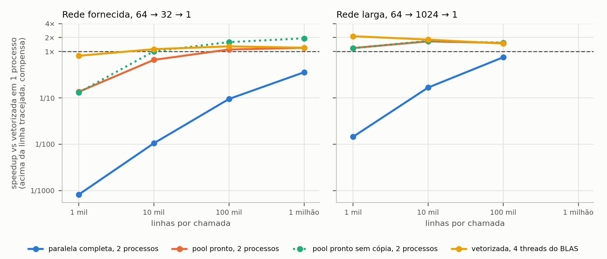

# Inferência e paralelização em CPU

Desafio 03 (HPC) · CloudWalk × IMPA Tech · Richard Elias Soares Viana

Inferência vetorizada e paralela de um MLP 64 → 32 → 1 em CPU, e um benchmark reproduzível
que mostra quando o paralelismo compensa, quanto ele custa e por quê.

## Visão geral (Overview)

O projeto:

1. **mede o custo da referência escalar** e mostra onde o tempo vai, parte por parte;
2. **implementa a inferência vetorizada** em um processo, preservando `float64`, a forma
   `(n, 1)` e a ordem das linhas;
3. **implementa a inferência paralela** com processos `spawn`, com entradas e saídas em
   memória compartilhada;
4. **confere todas as linhas** de todas as estratégias com as saídas esperadas
   (`rtol = atol = 1e-10`);
5. **mede latência, throughput e speedup** com 1 mil, 10 mil, 100 mil e 1 milhão de
   linhas, em rodadas pareadas, e explica os custos que determinam o resultado.

**Conclusão:** neste modelo, paralelizar com processos não compensou. A execução paralela
completa com 2 processos foi mais lenta que a vetorizada em todos os tamanhos (de 1/1.046
a 0,46×). Criar os processos custa ~120 ms, e validar e copiar os dados custa mais que o
cálculo que se economiza. Para mais vazão, as threads do próprio BLAS dão até 1,76× sem
criar processos.

Relatório técnico (duas páginas): [RELATORIO.md](RELATORIO.md)

## Arquitetura (Architecture)

| Módulo | Papel |
| --- | --- |
| [03-hpc/inferencia.py](03-hpc/inferencia.py) | Inferência: núcleo de cálculo, vetorizada, paralela e fundida |
| [03-hpc/benchmark.py](03-hpc/benchmark.py) | Mede todas as estratégias e grava os resultados em CSV e JSON |
| [03-hpc/analise_escalar.py](03-hpc/analise_escalar.py) | Decompõe o custo da referência escalar |
| [03-hpc/resumo.py](03-hpc/resumo.py) | Gera as tabelas e o gráfico a partir dos resultados |
| [03-hpc/test_inferencia.py](03-hpc/test_inferencia.py) | Testes de correção |
| [03-hpc/mlp.py](03-hpc/mlp.py) | Modelo, referência escalar e oráculo do enunciado |
| [03-hpc/gerar_entradas.py](03-hpc/gerar_entradas.py) | Gerador dos conjuntos sintéticos |
| [reproduzir.sh](reproduzir.sh), [Dockerfile](Dockerfile) | Execução de ponta a ponta |

Fluxo: `gerar_entradas.py` → testes → `analise_escalar.py` → `benchmark.py` → `resumo.py`.

Todas as estratégias usam o mesmo núcleo, `calcular_camadas` (`H = X W1 + b1;
y = H W2 + b2`, com produtos de matrizes do BLAS), e a mesma divisão das linhas em lotes,
`fatias`. A vetorizada aplica o núcleo em um processo. A paralela distribui os lotes
entre processos:

```text
 processo pai                     memória compartilhada (RawArray)      processos filhos (spawn)
 ------------                     --------------------------------      ------------------------
 1. valida X                                                            recebem os pesos (17 KB)
 2. copia X  ------------------>  X (n x 64)  --- lê X[início:fim] -->  uma vez, na criação
 3. envia as tarefas: só o par (início, fim), pela fila do pool ----->  4. aplicam o núcleo
 5. copia Y[:n]  <--------------  Y (n x 1)   <-- grava Y[início:fim] -    ao seu lote
```

- **Entradas e saídas:** ficam em memória compartilhada. Nenhuma linha de X passa por pipe
  ou pickle. Cada filho grava na faixa de Y das suas linhas, então a ordem é preservada por
  construção.
- **Pesos:** vão uma vez a cada filho, quando o processo é criado.
- **Tarefas:** lote padrão de ceil(n / processos), ou seja, uma tarefa por processo. Com
  `chunksize=1`, cada lote é exatamente uma tarefa: ceil(n / lote) tarefas.
- **Ciclo de vida:** `prever_paralelo` cria, usa e encerra os processos numa só chamada.
  `InferenciaParalela` mantém o pool aberto entre chamadas.

## Como executar (How to Run)

### Com Docker

```bash
docker build -t desafio-03-hpc .
```

```bash
docker run --rm --shm-size=2g desafio-03-hpc
```

O segundo comando roda tudo (~15 minutos). Para guardar os resultados na sua máquina:

```bash
docker run --rm --shm-size=2g -v "$PWD/03-hpc/resultados:/projeto/03-hpc/resultados" desafio-03-hpc
```

O `--shm-size=2g` dá espaço à memória compartilhada da inferência paralela.

### Com uv

Requisitos: [uv](https://docs.astral.sh/uv/), que instala o Python 3.12 e as versões
fixadas em `uv.lock`; `bash`; ~4 GB de RAM livres para o conjunto de 1 milhão de linhas.

```bash
uv sync --frozen
```

```bash
bash reproduzir.sh
```

O `reproduzir.sh` gera os quatro conjuntos (semente 2027) e roda os testes, a análise da
referência escalar, o benchmark e o resumo. Não há variáveis de ambiente obrigatórias: o
benchmark fixa `OPENBLAS_NUM_THREADS`, `MKL_NUM_THREADS`, `OMP_NUM_THREADS` e
`VECLIB_MAXIMUM_THREADS` em 1 antes de importar o NumPy, e os processos filhos herdam o
valor.

Cada passo também roda sozinho:

```bash
uv run --frozen python 03-hpc/gerar_entradas.py --rows 100000 --seed 2027 --output 03-hpc/dados/grande
```

```bash
uv run --frozen python -m unittest discover -s 03-hpc -p 'test_*.py' -v
```

```bash
uv run --frozen python 03-hpc/benchmark.py --conjuntos grande --repeticoes 5
```

| Opção do benchmark | Padrão | Uso |
| --- | --- | --- |
| `--conjuntos` | `pequeno medio grande enorme` | Pastas em `03-hpc/dados/` |
| `--estrategias` | `escalar vetorizado fundido paralelo` | Estratégias medidas |
| `--repeticoes` | `10` | Rodadas medidas, depois de 1 aquecimento |
| `--saida` | `03-hpc/resultados/benchmark` | Prefixo dos arquivos `.csv` e `.json` |

### Usando as funções

```python
from inferencia import InferenciaParalela, prever_paralelo, prever_vetorizado
from mlp import carregar_modelo

modelo = carregar_modelo()
y = prever_vetorizado(modelo, X)                  # X de forma (n, 64), float64
y = prever_paralelo(modelo, X, processos=2)       # cria, usa e encerra 2 processos

with InferenciaParalela(modelo, capacidade=len(X), processos=2) as paralela:
    y = paralela.prever(X)                        # pool reutilizado entre chamadas
```

As três devolvem `float64` de forma `(n, 1)`, na ordem das linhas de `X`, e levantam
`ValueError` se o número de features não for o do modelo. Com `spawn`, o programa que chama
`prever_paralelo` precisa estar sob `if __name__ == "__main__":`.

## Guia de demonstração (Demo Guide)

**Demonstração rápida (~30 s):** roda os testes e mede todas as estratégias com 1 mil e
10 mil linhas.

```bash
bash reproduzir.sh rapido
```

Ou, com Docker:

```bash
docker run --rm --shm-size=2g desafio-03-hpc bash reproduzir.sh rapido
```

O que observar:

1. os 17 testes terminam com `OK`;
2. o benchmark imprime o ambiente (CPU, versões, BLAS e threads observadas) e uma linha por
   configuração, com mediana e speedup contra a vetorizada. Antes de medir, ele confere
   todas as linhas de cada configuração e para com `AssertionError` se alguma estiver
   errada;
3. com 10 mil linhas, `paralelo completo p=2` fica perto de 0,01 (70 a 80 vezes mais
   lenta que a vetorizada), e `vetorizado threads do BLAS t=4` fica acima de 1.

**Execução completa (~15 min):** `bash reproduzir.sh` gera `03-hpc/resultados/`:

| Arquivo | Conteúdo |
| --- | --- |
| `benchmark.csv`, `benchmark.json` | Uma linha por configuração: tempos individuais, mediana, mínimo, máximo, throughput, speedups, lote, tarefas e diferença máxima; o JSON inclui o ambiente |
| `custo_escalar.json` | Custo de cada parte da linha mais executada da referência escalar |
| `resumo.md` | Sete tabelas com os resultados |
| `speedup_por_linhas.png` | Speedup contra a vetorizada, por tamanho |
| `logs/` | Saída dos testes, da análise escalar e do benchmark |

## Resultados

**Ambiente:** VM Linux com 4 vCPUs Intel Xeon 2,3 GHz, Python 3.12.3, NumPy 2.2.6 e
OpenBLAS 0.3.29, com 1 thread nativa por processo.

**Protocolo:** 1 aquecimento e 10 rodadas. Em cada rodada, todas as configurações do
conjunto são medidas em ordem sorteada, e o speedup é a mediana de
`tempo_vetorizada / tempo_estratégia` na mesma rodada. X fica na RAM antes de medir; a
validação das entradas fica dentro do intervalo medido, em todas as estratégias.

### Entrega mínima

Mediana em ms, com [mínimo – máximo]; speedup contra a vetorizada (1/k = k vezes mais lenta).

| Linhas | Escalar | Vetorizada | Paralela completa, 2 processos | Speedup da paralela |
|---:|---:|---:|---:|---:|
| 1.000 | 331 [315 – 388] | 0,120 [0,110 – 0,189] | 123 [117 – 158] | 1/1.046 |
| 10.000 | 3.304 [3.203 – 3.530] | 1,67 [1,30 – 2,13] | 125 [119 – 139] | 1/73 |
| 100.000 | 33.799 [33.119 – 34.624] | 21,8 [19,4 – 24,9] | 172 [163 – 189] | 0,13× |
| 1.000.000 | não medida | 279 [265 – 314] | 605 [568 – 682] | 0,46× |

| Throughput (obs/s) | 1.000 | 10.000 | 100.000 | 1.000.000 |
|---|---:|---:|---:|---:|
| Escalar | 3.020 | 3.026 | 2.959 | — |
| Vetorizada | 8.315.663 | 5.978.614 | 4.594.657 | 3.580.313 |
| Paralela completa, 2 processos | 8.162 | 79.864 | 582.139 | 1.654.079 |



### Quando cada estratégia compensa

Speedup contra a vetorizada em um processo (mediana pareada).

| Estratégia | 1.000 | 10.000 | 100.000 | 1.000.000 |
|---|---:|---:|---:|---:|
| Paralela completa, 2 processos | 1/1.046 | 1/73 | 0,13× | 0,46× |
| Paralela completa, 4 processos | 1/1.071 | 1/78 | 0,13× | 0,50× |
| Pool pronto, 2 processos | 0,19× | 0,71× | 0,82× | 1,24× |
| Pool pronto, 4 processos | 0,14× | 0,79× | 1,12× | 1,57× |
| Pool pronto, X já na memória compartilhada, 2 processos | 0,19× | 1,12× | 2,10× | 2,25× |
| Pool pronto, X já na memória compartilhada, 4 processos | 0,20× | 1,31× | 3,17× | 4,04× |
| Pool pronto, dados enviados por pickle, 2 processos | 1/12 | 0,12× | 0,16× | 0,19× |
| Vetorizada, 2 threads do BLAS | 0,99× | 1,29× | 1,39× | 1,36× |
| Vetorizada, 4 threads do BLAS | 1,09× | 1,47× | 1,70× | 1,76× |
| Vetorizada em lotes de 4.096 linhas | 0,96× | 1,03× | 1,00× | 1,37× |
| Fundida, y = Xw + b | 5,60× | 2,92× | 2,89× | 2,88× |

### Para onde vai o tempo

- **Referência escalar:** a linha mais executada (2.080 vezes por observação) custa
  ~151 ns. Desse tempo, 85% vão em ler elementos do array um a um e 7% na
  multiplicação-soma. A vetorizada é de 1.544 a 2.758× mais rápida.
- **Criar processos:** ~120 ms fixos (123 ms com 2 processos e 126 ms com 4, com 1 mil
  linhas), o equivalente a calcular ~550 mil linhas na vetorizada.
- **Mover os dados:** com 100 mil linhas e 2 processos, o cálculo paralelo leva 9,6 ms;
  validar e copiar X leva 13,9 ms, no processo pai. Mandar os lotes por pickle, em vez de
  usar memória compartilhada, foi 5 a 7× mais lento.
- **Tendência:** entre 100 mil e 1 milhão de linhas, cada linha adicional custou 481 ns na
  paralela completa e 286 ns na vetorizada; o speedup tende a ~0,6× e não chega a 1.

**Recomendação:** vetorizada em um processo, em lotes de alguns milhares de linhas para
entradas grandes. Para mais vazão, as threads do BLAS. Processos só se pagam com o pool
reutilizado e os dados já na memória compartilhada. Enquanto o modelo for linear, a fusão
das camadas dá ~2,9× com uma única thread.

### Correção

Os 17 testes (`03-hpc/test_hpc.py` e `03-hpc/test_inferencia.py`) cobrem todas as linhas
contra as saídas esperadas, uma única observação, lote final incompleto, ordem das linhas
com tarefas de 1 linha, número de features incompatível, reutilização do pool e uma rede
com outra arquitetura (8 → 5 → 3). No benchmark, todas as linhas das 75 configurações
foram conferidas antes de medir: a maior diferença foi 2,7 × 10⁻¹⁵, e 64 configurações
deram resultados idênticos bit a bit.

## Estrutura do repositório

```text
.
├── README.md
├── RELATORIO.md              relatório técnico (duas páginas)
├── Dockerfile, reproduzir.sh execução de ponta a ponta
├── pyproject.toml, uv.lock   ambiente fixado
└── 03-hpc/
    ├── README.md             enunciado
    ├── inferencia.py         vetorizada, paralela e fundida
    ├── benchmark.py          benchmark
    ├── analise_escalar.py    custo da referência escalar
    ├── resumo.py             tabelas e gráfico
    ├── test_inferencia.py    testes da inferência
    ├── mlp.py, gerar_*.py, exemplo.py, test_hpc.py
    ├── modelo/               pesos do MLP
    ├── dados/exemplo/        entradas e saídas esperadas de exemplo
    └── resultados/           medições, tabelas, gráfico e logs
```
