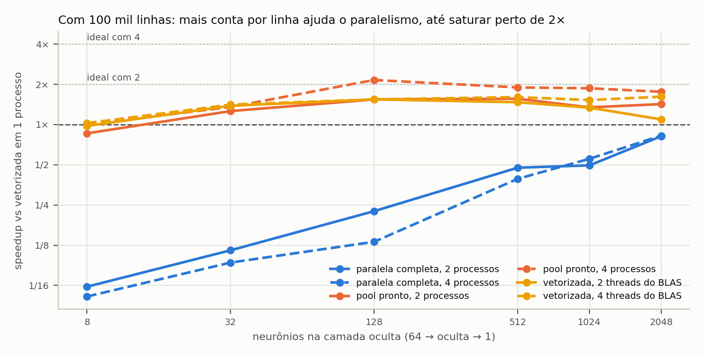

# Inferência e paralelização em CPU

Desafio 03 (HPC) · CloudWalk × IMPA Tech · Richard Elias Soares Viana

Inferência vetorizada e paralela de um MLP 64 → 32 → 1 em CPU, com um benchmark
reproduzível que mostra quando o paralelismo compensa, quanto custa e por quê. O relatório
técnico, de duas páginas, está em [relatorio/relatorio.pdf](relatorio/relatorio.pdf).

## Visão geral

O projeto mede o custo da implementação escalar de referência, implementa a inferência
vetorizada em um processo e a inferência paralela com processos `spawn`, confere todas as
linhas de todas as estratégias contra as saídas esperadas (`rtol = atol = 1e-10`) e mede
latência, throughput, speedup e memória com 1 mil, 10 mil, 100 mil e 1 milhão de linhas.
Um experimento adicional repete as medições com uma rede mais larga, 64 → 1024 → 1.

Com o modelo fornecido, paralelizar com processos não compensou: a execução paralela
completa com 2 processos foi mais lenta que a vetorizada em todos os tamanhos, de 1/1.222 a
0,36×. Criar os processos custa cerca de 220 ms, e cada linha tem pouca conta (2.080
multiplicações) para os dados que precisam ser movidos. Com a rede larga, que faz 32 vezes
mais conta por linha, o pool de processos reutilizado passa a ganhar da vetorizada em todos
os tamanhos, chegando a 2,3× com 4 processos.

## Arquitetura

| Arquivo | Função |
| --- | --- |
| [03-hpc/inferencia.py](03-hpc/inferencia.py) | Núcleo de cálculo e as inferências vetorizada, paralela e fundida |
| [03-hpc/benchmark.py](03-hpc/benchmark.py) | Mede todas as estratégias e grava os resultados em CSV e JSON |
| [03-hpc/analise_escalar.py](03-hpc/analise_escalar.py) | Decompõe o custo da referência escalar |
| [03-hpc/resumo.py](03-hpc/resumo.py) | Gera as tabelas e o gráfico a partir dos resultados |
| [03-hpc/test_inferencia.py](03-hpc/test_inferencia.py) | Testes de correção |
| [03-hpc/mlp.py](03-hpc/mlp.py) | Modelo, referência escalar e oráculo |
| [03-hpc/gerar_entradas.py](03-hpc/gerar_entradas.py) | Gerador dos conjuntos sintéticos |
| [reproduzir.sh](reproduzir.sh) e [Dockerfile](Dockerfile) | Execução de ponta a ponta |

Todas as estratégias usam o mesmo núcleo, `calcular_camadas`, que faz
`H = X W1 + b1; y = H W2 + b2` com produtos de matrizes, e a mesma divisão das linhas em
lotes, `fatias`. A versão vetorizada aplica o núcleo em um único processo. A paralela
distribui os lotes entre processos:

```text
 processo pai                     memória compartilhada (RawArray)      processos filhos (spawn)
 ------------                     --------------------------------      ------------------------
 1. valida X                                                            recebem os pesos (17 KB)
 2. copia X  ------------------>  X (n x 64)  --- lê X[início:fim] -->  uma vez, na criação
 3. envia as tarefas: só o par (início, fim), pela fila do pool ----->  4. aplicam o núcleo
 5. copia Y[:n]  <--------------  Y (n x 1)   <-- grava Y[início:fim] -    ao seu lote
```

Entradas e saídas ficam em memória compartilhada, então nenhuma linha de X passa por pipe
ou pickle. Cada filho grava na faixa de Y correspondente às suas linhas, o que preserva a
ordem. Os pesos são enviados uma única vez a cada filho, na criação do processo. O lote
padrão é ceil(n / processos), uma tarefa por processo; com `chunksize=1`, são sempre
ceil(n / lote) tarefas. `prever_paralelo` cria, usa e encerra os processos em uma chamada,
e `InferenciaParalela` mantém o pool aberto entre chamadas.

## Como executar

Com Docker:

```bash
docker build -t desafio-03-hpc .
```

```bash
docker run --rm --shm-size=2g -v "$PWD/03-hpc/resultados:/projeto/03-hpc/resultados" desafio-03-hpc
```

Com [uv](https://docs.astral.sh/uv/), que instala o Python 3.12 e as dependências fixadas
em `uv.lock`:

```bash
uv sync --frozen
```

```bash
bash reproduzir.sh
```

A execução completa leva cerca de 35 minutos e precisa de uns 4 GB de RAM livres. Ela gera
os conjuntos de dados (semente 2027), roda os testes, a análise da referência escalar, o
benchmark, os experimentos com redes maiores e o resumo, e grava tudo em `03-hpc/resultados/`. O benchmark fixa uma thread
nativa por processo (`OPENBLAS_NUM_THREADS` e afins) antes de importar o NumPy, então
nenhuma variável de ambiente precisa ser definida.

Os passos também podem ser executados separadamente:

```bash
uv run --frozen python -m unittest discover -s 03-hpc -p 'test_*.py' -v
```

```bash
uv run --frozen python 03-hpc/benchmark.py --conjuntos grande --repeticoes 5
```

O benchmark aceita `--conjuntos` (pastas em `03-hpc/dados/`), `--estrategias` (`escalar`,
`vetorizado`, `fundido`, `paralelo`), `--repeticoes` (padrão 10) e `--saida` (prefixo dos
arquivos de resultado).

Para usar as funções diretamente:

```python
from inferencia import InferenciaParalela, prever_paralelo, prever_vetorizado
from mlp import carregar_modelo

modelo = carregar_modelo()
y = prever_vetorizado(modelo, X)                  # X de forma (n, 64), float64
y = prever_paralelo(modelo, X, processos=2)       # cria, usa e encerra 2 processos

with InferenciaParalela(modelo, capacidade=len(X), processos=2) as paralela:
    y = paralela.prever(X)                        # pool reutilizado entre chamadas
```

Todas devolvem `float64` com forma `(n, 1)`, na ordem das linhas de `X`, e levantam
`ValueError` se o número de features for diferente do esperado pelo modelo.

## Demonstração

Para uma demonstração de cerca de 1 minuto, com os conjuntos de 1 mil e 10 mil linhas:

```bash
bash reproduzir.sh rapido
```

Ou com Docker:

```bash
docker run --rm --shm-size=2g desafio-03-hpc bash reproduzir.sh rapido
```

Os 17 testes devem terminar com `OK`. Em seguida, o benchmark mostra o ambiente (CPU,
versões, BLAS e threads) e uma linha por configuração, com a mediana do tempo e o speedup
em relação à vetorizada. Antes de medir, cada configuração tem todas as linhas conferidas
contra as saídas esperadas. Com 10 mil linhas, a paralela completa com 2 processos aparece
com speedup próximo de 0,01, e a vetorizada com 4 threads do BLAS, acima de 1.

## Resultados

Medidos em um notebook com Intel Core i7-1185G7 (4 núcleos, 8 threads), 16 GB, Linux no
WSL2, Python 3.12.14, NumPy 2.2.6 e OpenBLAS 0.3.29, com uma thread nativa por processo.
Cada configuração teve 1 aquecimento e 10 rodadas; em cada rodada, todas as configurações
foram medidas em ordem sorteada, e o speedup é a mediana das razões
`tempo_vetorizada / tempo_estratégia` dentro da mesma rodada.

Tempo mediano em ms, com mínimo e máximo; speedup em relação à vetorizada (1/k significa k
vezes mais lenta):

| Linhas | Escalar | Vetorizada | Paralela completa, 2 processos | Speedup da paralela |
|---:|---:|---:|---:|---:|
| 1.000 | 851 [783 – 1.020] | 0,176 [0,161 – 0,276] | 224 [197 – 265] | 1/1.222 |
| 10.000 | 8.973 [8.019 – 10.325] | 2,59 [1,86 – 8,82] | 242 [198 – 389] | 1/95 |
| 100.000 | 77.178 [53.945 – 89.758] | 23,1 [18,4 – 30,4] | 252 [177 – 353] | 1/11 |
| 1.000.000 | — | 229 [211 – 258] | 652 [524 – 1.469] | 0,36× |

Throughput, em observações por segundo:

| Estratégia | 1.000 | 10.000 | 100.000 | 1.000.000 |
|---|---:|---:|---:|---:|
| Escalar | 1.175 | 1.114 | 1.296 | — |
| Vetorizada | 5.694.209 | 3.867.482 | 4.335.082 | 4.373.044 |
| Paralela completa, 2 processos | 4.471 | 41.240 | 397.093 | 1.534.859 |


Speedup de cada estratégia em relação à vetorizada em um processo:

| Estratégia | 1.000 | 10.000 | 100.000 | 1.000.000 |
|---|---:|---:|---:|---:|
| Paralela completa, 2 processos | 1/1.222 | 1/95 | 1/11 | 0,36× |
| Paralela completa, 4 processos | 1/1.467 | 1/118 | 1/13 | 0,34× |
| Pool pronto, 2 processos | 0,14× | 0,66× | 1,11× | 1,20× |
| Pool pronto, 4 processos | 0,11× | 0,72× | 1,31× | 1,48× |
| Pool pronto, X já na memória compartilhada, 2 processos | 0,13× | 1,01× | 1,59× | 1,93× |
| Pool pronto, X já na memória compartilhada, 4 processos | 0,14× | 1,04× | 2,41× | 2,75× |
| Pool pronto, dados enviados por pickle, 2 processos | 1/16 | 0,15× | 0,17× | 0,16× |
| Vetorizada, 2 threads do BLAS | 1,16× | 1,25× | 1,32× | 1,22× |
| Vetorizada, 4 threads do BLAS | 0,81× | 1,12× | 1,29× | 1,21× |
| Vetorizada em lotes de 4.096 linhas | 0,91× | 1,18× | 1,14× | 1,22× |
| Fundida, y = Xw + b | 4,76× | 5,13× | 3,29× | 3,24× |

Na referência escalar, a linha mais executada (2.080 vezes por observação) custa cerca de
362 ns, dos quais 84% vão na leitura de elementos do array, um a um, e só 8% na
multiplicação e soma; a vetorizada é de 2.919 a 4.778 vezes mais rápida. Na paralela, criar
e encerrar os processos custa cerca de 220 ms fixos, o equivalente a calcular quase 1 milhão
de linhas na vetorizada. Com 100 mil linhas e 2 processos, o cálculo paralelo leva 13,3 ms e
validar e copiar X para a memória compartilhada, mais 7,1 ms, no processo pai. Entre 100 mil
e 1 milhão de linhas, cada linha adicional custou 444 ns na paralela completa e 228 ns na
vetorizada, de modo que o speedup tende a cerca de 0,5× e não chega a 1. Enviar os dados por
pickle, em vez de usar memória compartilhada, foi de 6 a 9 vezes mais lento.

Acréscimo de memória (RSS do processo pai somada à dos filhos) durante uma chamada, em MB:

| Estratégia | 100.000 | 1.000.000 |
|---|---:|---:|
| Vetorizada, 1 processo | 0 | 256 |
| Paralela completa, 2 processos | 206 | 1.321 |
| Paralela completa, 4 processos | 290 | 1.339 |
| Pool pronto, 2 processos | 0 | 256 |
| Pool pronto, dados enviados por pickle, 2 processos | 50 | 537 |

A paralela completa soma os interpretadores novos e a memória compartilhada recém-alocada; o
pool pronto não acrescenta nada além do temporário do cálculo, e o pickle mantém cópias de X
em trânsito. A RSS conta uma vez em cada processo as páginas compartilhadas que ele toca, e
picos mais curtos que o intervalo de amostragem (1 ms) podem escapar.

Com a rede mais larga, 64 → 1024 → 1, cada linha passa a ter 32 vezes mais conta com os
mesmos 512 bytes de entrada:

| Rede 64 → 1024 → 1 | 1.000 | 10.000 | 100.000 |
|---|---:|---:|---:|
| Vetorizada, 1 processo (ms) | 4,11 | 51,9 | 454 |
| Paralela completa, 2 processos | 1/69 | 0,17× | 0,75× |
| Paralela completa, 4 processos | 1/126 | 1/11 | 0,55× |
| Pool pronto, 2 processos | 1,19× | 1,66× | 1,53× |
| Pool pronto, 4 processos | 1,27× | 2,28× | 1,91× |
| Pool pronto, dados enviados por pickle, 2 processos | 0,94× | 1,32× | 1,21× |
| Vetorizada, 4 threads do BLAS | 2,14× | 1,81× | 1,48× |

Agora o custo de mover os dados fica pequeno diante do cálculo: o pool reutilizado ganha em
todos os tamanhos, até enviando os dados por pickle, e a paralela completa sobe para 0,75×
com 100 mil linhas. O que decide se o paralelismo com processos compensa é a quantidade de
conta por byte movido.

Para ver a tendência inteira, a camada oculta foi variada de 8 a 32.768 neurônios, com 10
mil linhas e 5 rodadas. Com 100 mil linhas, o temporário H da maior rede teria 26 GB.



| Camada oculta | 8 | 32 | 128 | 512 | 2048 | 8192 | 32768 |
|---|---:|---:|---:|---:|---:|---:|---:|
| Vetorizada, 1 processo (ms) | 0,626 | 1,50 | 5,99 | 24,6 | 91,2 | 368 | 1.506 |
| Paralela completa, 2 processos | 1/226 | 1/90 | 1/46 | 1/11 | 0,32× | 0,63× | 1,02× |
| Paralela completa, 4 processos | 1/284 | 1/115 | 1/85 | 1/20 | 0,18× | 0,52× | 1,03× |
| Pool pronto, 2 processos | 0,37× | 0,66× | 1,20× | 1,80× | 1,69× | 1,49× | 1,59× |
| Pool pronto, 4 processos | 0,36× | 0,69× | 1,24× | 1,99× | 2,14× | 1,99× | 2,00× |
| Pool pronto, 4 processos, lotes de 512 linhas | 0,23× | 0,53× | 1,58× | 2,54× | 2,49× | 2,03× | 1,81× |
| Vetorizada, 4 threads do BLAS | 1,04× | 1,37× | 1,67× | 1,63× | 1,72× | 1,43× | 1,40× |

A paralela completa melhora continuamente, de 1/226 com 8 neurônios até empatar com a
vetorizada com 32.768 (1,02×): só aí a conta de cada chamada (1,5 s) dilui o custo de criar
os processos. O pool pronto passa de 1× a partir de 128 neurônios e se estabiliza perto de
2× com 4 processos, metade do ideal. Lotes de 512 linhas levam a 2,5× nos tamanhos médios,
porque o temporário H cabe melhor no cache, mas não ajudam na maior rede. A hipótese para o
teto restante é o próprio notebook: 4 núcleos físicos dividindo a banda de memória e
rodando a uma frequência menor quando todos estão ocupados.

A estratégia recomendada para o modelo fornecido é a vetorizada em um processo, em lotes de
alguns milhares de linhas para entradas grandes. Para mais vazão, as threads do BLAS.
Processos só compensam com o pool reutilizado e com bastante conta por linha. Enquanto o
modelo for linear, a fusão das camadas dá de 3,2 a 5,1× com uma única thread.

Os 17 testes cobrem a conferência de todas as linhas com as saídas esperadas, uma única
observação, lote final incompleto, preservação da ordem com tarefas de uma linha, número de
features incompatível, reutilização do pool e uma rede com outra arquitetura (8 → 5 → 3).
No benchmark, as 129 configurações das duas redes foram conferidas antes de medir: a maior
diferença foi de 4,9 × 10⁻¹⁵, e 81 delas produziram resultados idênticos bit a bit.

Os dados completos estão em [03-hpc/resultados/](03-hpc/resultados/): tempos individuais
e memória em `benchmark.csv`, `benchmark.json`, `largo.csv`, `largo.json` e na pasta
`varredura/`, tabelas em `resumo.md`, os gráficos e os logs de execução.
