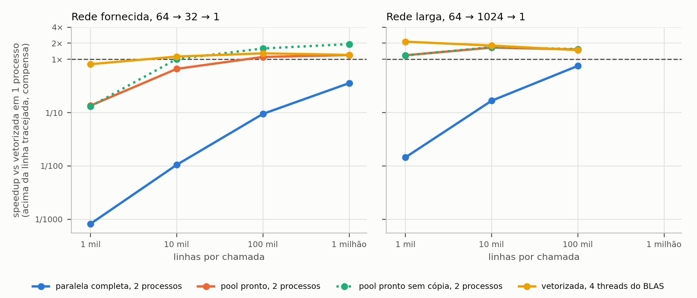

# Inferência e paralelização em CPU: relatório

Richard Elias Soares Viana · Desafio 03-hpc, CloudWalk × IMPA Tech

**Conclusão.** Para este MLP linear 64 → 32 → 1, paralelizar com processos não compensou.
A execução paralela completa com 2 processos `spawn` foi mais lenta que a vetorizada em um
processo em todos os tamanhos medidos, de 1 mil a 1 milhão de linhas. O cálculo em si fica
2 a 4× mais rápido quando dividido. O que pesa é criar os processos (~120 ms) e levar os
dados até eles. Recomendo a vetorizada em um processo e, se faltar vazão, as threads do BLAS.

## 1. Ambiente e protocolo

- **Máquina:** VM Linux (KVM), 4 vCPUs Intel Xeon 2,3 GHz, 16,9 GB; Python 3.12.3, NumPy
  2.2.6, OpenBLAS 0.3.29. Pedi 1 thread nativa por processo (`OPENBLAS_NUM_THREADS` e afins
  = 1, antes de importar o NumPy); o `psutil` observou 1 thread no pai e 1 no filho.
- **Dados:** semente 2027; 1 mil, 10 mil e 100 mil linhas, mais 1 milhão para conferir a
  tendência. X fica inteiro na RAM antes de medir: leitura do disco e carga do modelo ficam
  fora do intervalo. A validação das entradas (forma, tipo, finitos) fica dentro, em todas.
- **Medição:** `time.perf_counter`, 1 aquecimento e 10 rodadas. Em testes preliminares o
  mesmo cálculo de 100 mil linhas variou ~30% entre execuções (12 a 16 ms); por isso cada rodada mede todas as
  configurações do conjunto, em ordem sorteada, e o speedup é a mediana de
  `tempo_vetorizada / tempo_estratégia` na mesma rodada (**rodadas pareadas**). Cada
  configuração roda duas vezes seguidas e só a segunda conta, para não herdar o cache.
- **Correção:** antes de medir, todas as linhas das 75 configurações foram conferidas com
  `saidas_esperadas.npy` (`rtol = atol = 1e-10`, forma, tipo, finitos e ordem). Maior
  diferença: 2,7 × 10⁻¹⁵; 64 configurações deram resultados idênticos bit a bit.

## 2. Implementação

`inferencia.py` tem um núcleo único, `H = X W1 + b1; y = H W2 + b2`, feito com produtos de
matrizes e bias somado in-place, o que evita alocar uma segunda matriz n × 32. A
**vetorizada** aplica o núcleo em um processo. A **paralela** é a mesma coisa, com o laço de
lotes distribuído entre processos `spawn`:

- **Entradas e saídas** ficam em memória compartilhada (`RawArray`). O pai copia X uma vez,
  e cada filho lê só a sua fatia e grava em `Y[início:fim]`; a ordem sai certa por
  construção.
- **Pesos** (17 KB) vão uma vez a cada filho, na criação do processo.
- **Tarefas** são só o par `(início, fim)`. O lote padrão é ceil(n / processos): como toda
  linha custa o mesmo, uma tarefa por processo divide o trabalho por igual com o mínimo de
  mensagens. Com `chunksize=1` são ceil(n / lote) tarefas, ou seja, 2 com 2 processos.

## 3. Resultados

**Tabela 1.** Entrega mínima: mediana [mín – máx] de 10 rodadas, em ms; speedup pareado
contra a vetorizada (1/k = k vezes mais lenta).

| Linhas | Escalar (referência) | Vetorizada, 1 processo | Paralela completa, 2 processos | Speedup da paralela |
|---:|---:|---:|---:|---:|
| 1.000 | 331 [315 – 388] | 0,120 [0,110 – 0,189] | 123 [117 – 158] | 1/1.046 |
| 10.000 | 3.304 [3.203 – 3.530] | 1,67 [1,30 – 2,13] | 125 [119 – 139] | 1/73 |
| 100.000 | 33.799 [33.119 – 34.624] | 21,8 [19,4 – 24,9] | 172 [163 – 189] | 0,13× |
| 1.000.000 | não medida | 279 [265 – 314] | 605 [568 – 682] | 0,46× |

Throughput: escalar ~3 mil obs/s; vetorizada de 3,6 a 8,3 milhões; paralela de 8 mil a 1,7 milhão.

## 4. Passo a passo: para onde vai o tempo

1. **A referência escalar é lenta por causa do interpretador, não da conta.** Sua linha mais
   executada (2.080 vezes por observação) custa ~151 ns. Desse tempo, 85% vão em ler
   elementos do array um a um (cada leitura cria um objeto `numpy.float64`) e só 7% na
   multiplicação-soma. Isso estima 314 µs por observação; medi 338 µs. A vetorizada troca
   os laços por dois produtos de matrizes e fica de 1.544 a 2.758× mais rápida.
2. **Criar processos custa ~120 ms fixos.** Com 1 mil linhas, em que os dados são
   desprezíveis, a paralela completa levou 123 ms com 2 processos e 126 ms com 4. É o tempo
   de iniciar um Python novo por filho, importar o NumPy e encerrar. Equivale a calcular
   ~550 mil linhas na vetorizada.
3. **Validar e copiar os dados custa mais que o cálculo dividido.** Na Tabela 2, com o pool já criado e X já na
   memória compartilhada, 2 processos calculam 100 mil linhas em 9,6 ms. Validar e copiar X
   soma 13,9 ms, mais que o próprio cálculo, e essa parte é serial, no processo pai.
4. **Não compensa nem com n muito grande.** Entre 100 mil e 1 milhão de linhas, cada linha
   adicional custou 481 ns na paralela completa e 286 ns na vetorizada: alocar memória
   compartilhada nova e copiar X custam mais por linha do que o cálculo dividido economiza.
   Pela tendência, o speedup fica abaixo de ~0,6× (0,65× com 4 processos). Isso é
   extrapolação; o maior valor medido foi 0,46×, em 1 milhão.
5. **Entre as opções com processos, a memória compartilhada é a certa.** Mandar cada lote
   de X por pickle, no mesmo pool já pronto, foi 5 a 7× mais lento (133 contra 25,8 ms em
   100 mil linhas).

**Tabela 2.** Cenários com 100 mil linhas (ms). As diferenças são medianas pareadas e
agregam várias parcelas; não isolam cada custo.

| Processos | Vetorizada | Pool pronto, sem cópia | Pool pronto | Completa | Validar + copiar X | Criar processos + alocar memória |
|---:|---:|---:|---:|---:|---:|---:|
| 2 | 21,8 | 9,62 | 25,8 | 172 | 13,9 | 142 |
| 4 | 21,8 | 6,72 | 20,0 | 175 | 13,3 | 155 |

## 5. Extensões

- **Lotes e 4 processos.** Com o pool pronto, 4 processos chegam a 1,12× (100 mil) e
  1,57× (1 milhão). Parte disso é efeito do lote, não dos processos. A própria vetorizada
  em lotes de 4.096 linhas fica 1,37× mais rápida em 1 milhão, porque deixa de alocar de
  uma vez um temporário H de 256 MB. Com o mesmo lote nas duas, 2 processos empatam (1,38×
  contra 1,37×) e 4 processos ganham ~1,2×. Lotes de 512 linhas geram até 1.954 tarefas e
  pioram: cada tarefa a mais custou de 10 a 17 µs.
- **Threads do BLAS, sem processos.** Subir o limite de threads do OpenBLAS no próprio
  processo deu de 1,29 a 1,39× com 2 threads e de 1,47 a 1,76× com 4, a partir de 10 mil
  linhas. Não há cópia nem criação de processos: as threads leem o mesmo X.
- **Fusão y = Xw + b.** São 64 multiplicações por linha em vez de 2.080: 2,9× (5,6× com
  1 mil linhas). Preparar w e b leva 3,7 µs e se paga na primeira chamada. A fusão reduz
  trabalho e não mede paralelismo; só vale enquanto não houver ativação entre as camadas.

## 6. Recomendação

Para este modelo, a vetorizada em um processo, em lotes de alguns milhares de linhas quando
a entrada é grande. Se precisar de mais vazão na mesma máquina, as threads do BLAS (até 1,76×
com 4). Processos só se pagam com pool reutilizado e dados que já nasçam na memória
compartilhada (2,1 a 4,0× medidos nesse cenário); criar processos a cada chamada não
compensou em nenhum tamanho. Enquanto o modelo for linear, fundir as camadas dá ~2,9× com um só
processo e uma só thread.

## 7. Limitações

- Uma única VM compartilhada de 4 vCPUs: o pareamento protege as comparações, mas os tempos
  absolutos mudam entre execuções. O teto de ~0,6× vem da tendência entre dois tamanhos.
- "Pool pronto, sem cópia" pula validação e cópia: é um limite superior do ganho com
  processos, não uma estratégia completa (por isso passa de 2× com 2 processos).
- Não medi memória (por construção, X existe duas vezes e cada filho só aloca o seu lote),
  nem a referência escalar em 1 milhão de linhas (~6 minutos por chamada).

Para reproduzir: `bash reproduzir.sh`. Dados completos e tabelas extras em
`03-hpc/resultados/`; decisões e testes em `SOLUCAO.md`.
